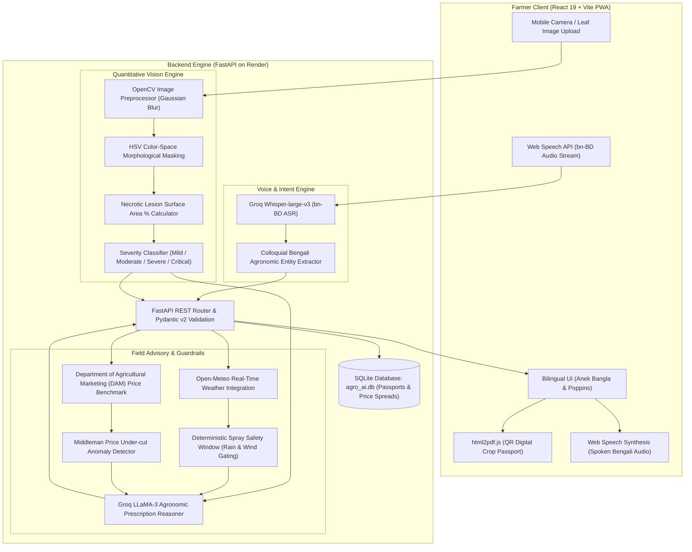

# Onkur (অঙ্কুর) — AI Field Intelligence & Agricultural Protection Platform 🌱

> **A voice-first, climate-resilient field intelligence companion for smallholder farmers in Bangladesh.**  
> Engineered by **Team Gray Metrics** for the *International AI Builders Congress: Idea to Unicorn*.  
> Combines conversational Bengali symptom intake, OpenCV-driven leaf pathology segmentation, localized weather-gated spray safety windows, middleman syndicate price alerts, and verifiable QR-coded Digital Crop Passports.

[](https://agro-ai-sooty.vercel.app)
[](https://agro-ai-backend-5uto.onrender.com)
[](https://fastapi.tiangolo.com)
[](https://python.org)
[](https://react.dev)
[](https://vitejs.dev)
[](https://opencv.org)
[](https://groq.com)

---

## 🌾 The Problem & The "Onkur" Mission

Over 70% of Bangladeshi smallholder farmers are functionally locked out of traditional agricultural technology due to literacy and language barriers. Furthermore, standard digital tools fail to address the core daily risks of rural agriculture:

1. **The Literacy & Dialect Trap:** Rural farmers cannot type botanical symptoms or navigate dense English drop-downs. They describe plant illness verbally in regional dialects (e.g., Bogura, Rangpur, Jessore).
2. **The "Blind Spraying" Disaster:** Lacking meteorological context, farmers spray costly chemical pesticides hours before rain, washing away active ingredients, polluting local canals, and wasting critical household savings.
3. **Superficial "Toy" Scanners:** Generic AI apps return textbook disease names without calculating physical damage percentage, calibrating chemical dosages, or providing mandatory Pre-Harvest Intervals (PHI).
4. **Middleman Syndicate Exploitation:** Farmers have zero market intelligence, forcing them to sell fresh harvests to local syndicates (farias/aratdars) at 30–50% below government fair baselines.

**Onkur (অঙ্কুর)**—meaning *new sprout*—bridges this divide with an honest, lightweight, high-speed field intelligence platform designed specifically for low-end smartphones and low-bandwidth rural connectivity.

---

## 🏛️ System Architecture



---

## 🔬 Core Technical Capabilities

### 1. Voice-First Bengali Dialect Intake (`backend/services/nlp_intake.py`)
* Captures raw spoken Bengali audio (`bn-BD`) via the browser's Web Speech API and Groq Whisper.
* Employs structured prompt contracts to extract essential parameters: `crop_name`, `planting_time`, `symptoms`, and `affected_part`.
* Normalizes regional agricultural jargon (e.g., *"আলুর মড়ক"*, *"ধানের ব্লাস্ট"*, *"পাতা কুঁকড়ানো"*, *"লেদা পোকা"*) into standardized botanical entities with zero manual typing.

### 2. Quantitative OpenCV Lesion Segmentation (`backend/services/vision_engine.py`)
* Instead of relying on opaque, expensive cloud vision wrappers, Onkur executes server-side OpenCV image processing:
  * Applies Gaussian blur filtering to reduce noisy mobile camera artifacts.
  * Transforms color spaces into **HSV (Hue, Saturation, Value)** to isolate necrotic spots, fungal mycelium, and chlorotic yellowing.
  * Calculates the exact mathematical ratio of necrotic lesion pixels to total foliage surface area:
    $$\text{Damage Severity \%} = \left( \frac{\text{Lesion Pixels}}{\text{Total Foliage Pixels}} \right) \times 100$$
  * Categorizes into calibrated risk tiers: **Mild (<15%)**, **Moderate (15–30%)**, **Severe (30–50%)**, and **Critical (>50%)**.

### 3. Climate-Gated Spray Safety Window (`backend/services/weather_service.py`)
* Queries hyper-local hourly meteorological telemetry from the **Open-Meteo API** (precipitation probability, relative humidity, temperature, and 10m wind velocity).
* Enforces deterministic safety thresholds:
  * **Risky Spray Warning:** Triggered if precipitation probability exceeds **40%** within 6–12 hours, or if wind speed exceeds **15 km/h** (preventing chemical drift and toxic runoff).
  * Saves farmers from wasting high-cost chemical inputs hours before monsoonal showers.

### 4. 4-Tier Calibrated Treatment Regimen (`backend/services/pathology_service.py`)
* Grounded in Bangladesh Agricultural Research Institute (**BARI**) crop protection standards.
* Delivers an actionable 4-tier action plan:
  1. **Chemical Treatment:** Specific active ingredients with legally mandated **Pre-Harvest Intervals (PHI)** in days.
  2. **Organic Biocontrol:** Eco-friendly non-chemical alternatives (Neem seed oil, Trichoderma).
  3. **Cultural Management:** Field drainage, sunlight exposure, and crop spacing.
  4. **Fertilizer Balancing:** Recommended N-P-K (Urea, TSP, DAP, MOP) ratio adjustments per decimal.

### 5. Middleman Syndicate Anomaly Detector (`backend/services/anomaly_detector.py`)
* Compares local market offers against official Department of Agricultural Marketing (**DAM**) wholesale baselines.
* Flags syndicate exploitation when local rates fall more than **15%** below official benchmarks, estimating revenue loss per mound/kg.

### 6. Verifiable Digital Crop Passport (`frontend/src/`)
* Generates a one-page, client-side vector PDF using `html2pdf.js`.
* Features an embedded, scannable **QR Code verification hash** that records farmer location, crop type, severity score, and timestamp.
* Serves as verifiable proof for micro-credit agricultural loans, crop insurance claims, and wholesale fair-price negotiations.

---

## 📂 Project Structure

```text
agro-ai/
├── backend/                        # FastAPI Python Backend
│   ├── config.py                   # API keys, path definitions, Groq & Open-Meteo configs
│   ├── database.py                 # SQLAlchemy database session & engine
│   ├── main.py                     # FastAPI application entrypoint & middleware
│   ├── data/                       # Ground-truth pathology databases & crop dictionaries
│   ├── models/                     # SQLAlchemy ORM models (CropPassport, MarketRate)
│   ├── routes/                     # REST API route handlers
│   │   ├── intake_routes.py        # Voice and text symptom intake endpoints
│   │   ├── vision_routes.py        # Image pathology analysis endpoints
│   │   ├── weather_routes.py       # Open-Meteo weather advisory endpoints
│   │   ├── market_routes.py        # Market syndicate anomaly endpoints
│   │   └── passport_routes.py      # Digital Crop Passport generation endpoints
│   ├── schemas/                    # Pydantic v2 request/response data contracts
│   └── services/                   # Core business logic & AI pipelines
│       ├── nlp_intake.py           # Speech parsing & LLaMA-3 intent extraction
│       ├── vision_engine.py        # OpenCV HSV lesion segmentation & severity math
│       ├── pathology_service.py    # BARI-grounded crop pathology database lookup
│       ├── weather_service.py      # Weather telemetry & spray safety index
│       └── anomaly_detector.py     # Middleman price deviation algorithms
│
├── frontend/                       # React 19 + Vite Web Application
│   ├── index.html                  # HTML5 entrypoint with Google Fonts (Anek Bangla, Poppins)
│   ├── package.json                # Dependencies (React 19, Lucide React, html2pdf.js, Axios)
│   ├── vite.config.ts              # Vite bundle configuration
│   └── src/
│       ├── App.jsx                 # Top-level workspace coordinator & navigation
│       ├── main.jsx                # React root entrypoint
│       ├── index.css               # Modern emerald palette styles
│       ├── components/             # Reusable UI modules
│       │   ├── VoiceIntakeCard.jsx # Web Speech API voice intake with sample chips
│       │   ├── LeafScanner.jsx     # Leaf upload, camera stream & damage % gauge
│       │   ├── WeatherCard.jsx     # Live Open-Meteo weather & spray safety indicator
│       │   ├── MarketCard.jsx      # Syndicate price undercut comparison chart
│       │   ├── CropPassport.jsx    # QR-coded printable PDF synthesis preview
│       │   └── FertilizerCalc.jsx  # Decimal-wise N-P-K dosage calculator
│       └── utils/                  # Helper utilities & API connectors
│
├── requirements.txt                # Python backend dependencies
└── README.md                       # Master technical whitepaper & documentation
```

---

## 🚀 Local Development Setup

### Prerequisites
* **Node.js** v18+ and **npm**
* **Python** 3.10+
* A free **Groq Cloud API Key** (for LLaMA-3 and Whisper inference)

### 1. Clone the Repository
```bash
git clone https://github.com/sabrinamaimon/agro-ai.git
cd agro-ai
```

### 2. Backend Setup (FastAPI)
```bash
# Create and activate a virtual environment
python3 -m venv venv
source venv/bin/activate    # On Windows: venv\Scripts\activate

# Install backend dependencies
pip install -r requirements.txt

# Configure environment variables
cp .env.example .env
# Edit .env and insert your GROQ_API_KEY

# Start the FastAPI backend server
uvicorn backend.main:app --reload --port 8000
```
* Interactive Swagger API Docs will be available at: `http://localhost:8000/docs`

### 3. Frontend Setup (React 19 + Vite)
```bash
# Open a new terminal and navigate to frontend
cd frontend

# Install dependencies
npm install

# Start the Vite development server
npm run dev
```
* Open `http://localhost:5173` in Google Chrome (recommended for full Web Speech API audio support).

---

## 🛡️ Responsible AI, Safety & Privacy

* **Zero Harmful Recommendations:** Onkur strictly prohibits recommending lethal chemical combinations or WHO Class Ia/Ib pesticides. Every chemical active ingredient is coupled with mandatory safety intervals (PHI) and eco-friendly organic alternatives.
* **Environmental Stewardship:** By integrating real-time rainfall forecasts, Onkur prevents farmers from spraying chemicals immediately before rainstorms, directly mitigating chemical runoff into Bangladesh's delta waterways.
* **Farmer Privacy by Design:** Onkur collects zero biometric, financial, or national identity data. Location coordinates are utilized in-memory strictly for querying localized weather forecasts and are immediately anonymized.

---

## 👥 Team Gray Metrics

* **Sabrina Maimon Mihiya** — *Team Lead, Product Architect & Frontend Engineer*
* **Md. Shifat Reza** — *AI Systems & Full-Stack Engineer*
* **Muntakim Fuad Mahi** — *Agronomic Logic & Research*
* **Sadia Binte Alam** — *UI/UX & Product Design*

---

## 📄 License
This project is open-source under the [MIT License](LICENSE). Built with heart for the farmers of Bangladesh.
